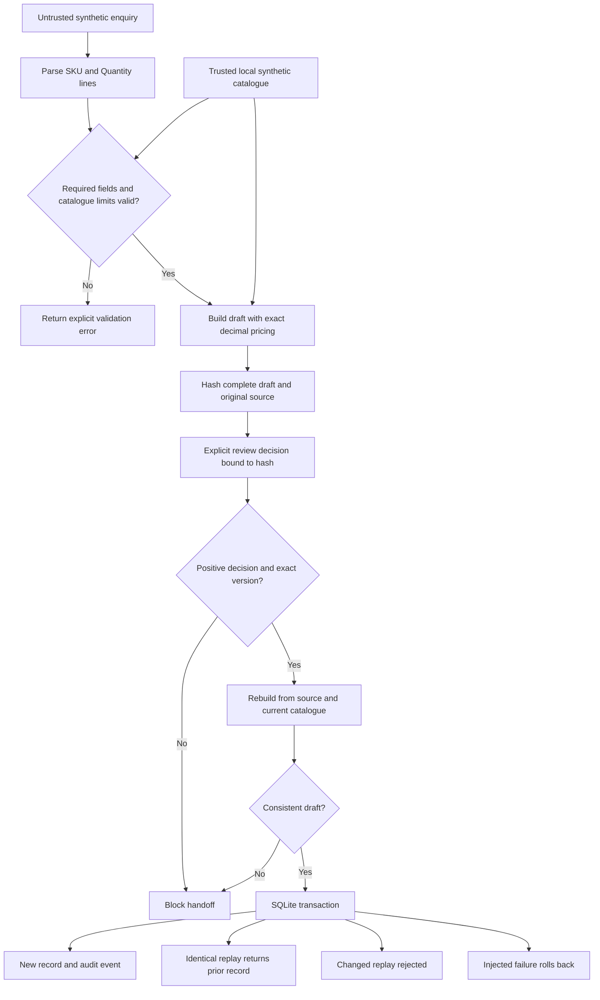

# Architecture and trust boundaries

## One local path

There is no network path. `LocalCRM` is a local SQLite adapter named for the role it simulates. It does not call a third-party CRM, an ERP system or a model provider.

## Boundary decisions

| Boundary | Rule | Limit |
|---|---|---|
| Customer message → fields | The enquiry envelope accepts only `inquiry_id`, `buyer_label` and `message`. Only full `SKU:` and `Quantity:` lines within the message are parsed. Repeated fields are rejected. Other message text is data. | Free-form emails and attachments are not understood. |
| Fields → business values | SKU must exist in the local catalogue; quantity must be a positive ASCII whole number within its limit. | Only one line item is supported. |
| Catalogue → price | Catalogue objects are validated even when supplied directly in code. Prices are bounded positive decimal strings; quantity limits are bounded integers excluding booleans. `Decimal` calculates totals. | The catalogue is trusted local input; there is no independent pricing service. |
| Draft → review | The entire dataclass is hashed, including the source hash and catalogue version. | A digest detects changes; it does not authenticate the reviewer. |
| Review → handoff | Decision must be positive, hash must match, and the draft's exact canonical representation must match a rebuild from source and current catalogue. A quantity of `true` or `1.0` cannot substitute for integer `1`. | Review records are local objects; a local caller can construct one. Production authorization is deliberately absent. |
| Handoff → persistence | A transaction and unique enquiry ID prevent partial writes and duplicate records. | Only local SQLite behavior is demonstrated. |

## Data and state

`QuoteDraft` is immutable in ordinary application use. Its fields include the enquiry identifier, buyer label, SKU, quantity, currency, unit price, total, catalogue version and source hash. Its status is always `DRAFT_REQUIRES_REVIEW`; a completed handoff is a separate result, not an automatically sent quotation.

`ApprovalRecord` stores the exact draft hash, a reviewer label and `approve` or `reject`. The demo deliberately uses the label `SCRIPTED_SYNTHETIC_REVIEWER`. A person's identity is not inferred from that string.

The local database contains:

- `crm_handoffs`: one record per enquiry ID, with draft and review data as JSON.
- `audit_events`: committed handoff and identical-replay events, with enquiry IDs and hashes. These events are not signed or tamper-proof.

Validation failures and rolled-back transactions are surfaced in the generated scenario report. They are not written as committed audit events in the database. A real service needs a separate protected operational logging path for unsuccessful actions.

## Idempotency and recovery

The enquiry identifier is the idempotency key. `BEGIN IMMEDIATE` serializes the read-before-write decision within SQLite. After source and current-catalogue validation, repeating the same identifier and draft returns the existing record. Reusing the identifier for a different valid draft raises a conflict; it does not silently update an order. If the catalogue has changed, an old draft fails validation before replay lookup, even if it was previously committed. The original record is preserved; this reference does not implement historical-result reconciliation after rule changes.

The failure-injection flag raises a local exception after an insertion but before transaction commit. SQLite rolls back both the handoff and its transaction. The runner then issues one explicit retry. This demonstrates local atomicity and retry safety, not distributed exactly-once delivery or a real CRM outage.

## Files on disk

Fixtures live under `examples/`; only synthetic information belongs there. A fresh temporary database is used for each demo run, then copied to `artifacts/crm-demo.sqlite3` for inspection. The report, sample draft and scripted review are also written to `artifacts/`. Rerunning the demo replaces these generated evidence files.

The application makes no remote requests and contains no key or credential configuration. Local outputs remain on the machine until the operator removes them. `.gitignore` prevents ordinary accidental inclusion of generated artifacts, but it is not an access control.
